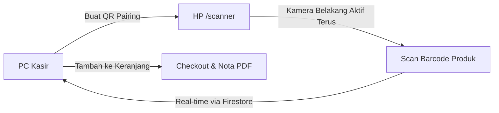

<div align="center">

# 🛒 KasirKu

**Aplikasi Point of Sale (POS) Modern untuk Toko Ritel & Multi-Cabang**

Kelola transaksi kasir lebih cepat, pantau stok *real-time*, ubah HP menjadi pemindai barcode nirkabel, analisis tren pendapatan dengan grafik interaktif, dan cetak nota langsung ke PDF.

[](https://react.dev/)
[](https://vitejs.dev/)
[](https://firebase.google.com/)
[](https://recharts.org/)
[](https://vitest.dev/)

[✨ Fitur Utama](#-fitur-utama) •
[📱 Mode Pemindai](#-ekosistem-pemindai-barcode-3-in-1) •
[🏗️ Arsitektur](#️-struktur-proyek) •
[🚀 Cara Menjalankan](#-cara-menjalankan) •
[🧪 Pengujian](#-pengujian--build)

</div>

---

## 💡 Tentang KasirKu

**KasirKu** dirancang untuk membantu pemilik usaha ritel—baik toko tunggal maupun jaringan multi-cabang—menjalankan operasional kasir harian secara ringan, responsif, dan terpusat di browser. Seluruh data produk, transaksi, shift kasir, dan sesi pemindai tersinkronisasi secara *real-time* melalui **Cloud Firestore** dengan autentikasi aman berbasis **Firebase Auth (Google Sign-In)**.

---

## ✨ Fitur Utama

### 🛍️ Kasir (POS) Cepat & Pembayaran Fleksibel
- **Keranjang Instan**: Tambah item lewat klik katalog, pencarian nama/kode, atau scan barcode langsung masuk ke keranjang.
- **Multi-Metode Pembayaran**: Mendukung pembayaran **Tunai** (dengan kalkulator kembalian otomatis), **QRIS**, **Transfer**, serta **Pembayaran Campuran (*Split Payment*)**.
- **Nota Transaksi & Cetak PDF**: Setelah checkout atau dari riwayat transaksi, tampilkan modal pratinjau nota berdesain rapi lengkap dengan stempel `LUNAS / PAID`, rincian pembayaran, lalu cetak ke printer thermal (`58mm`/`80mm`) maupun simpan langsung sebagai **PDF**.

### 📦 Manajemen Inventaris & Label Barcode
- **Auto-Barcode EAN-13**: Kolom barcode yang dikosongkan saat membuat produk akan otomatis diisi barcode EAN-13 internal yang valid.
- **Scan Langsung di Form Produk**: Input barcode pada modal Tambah/Edit Produk terhubung langsung dengan kamera perangkat maupun *Remote Scanner* HP—tanpa perlu mengetik manual.
- **Cetak Label Harga**: Cetak label barcode beserta nama dan harga produk langsung dari daftar inventaris.
- **Kontrol Stok Ketat**: Pelacakan pergerakan stok (awal, penjualan, retur, stok masuk, penyesuaian), peringatan otomatis stok menipis, dan arsip produk tanpa menghapus riwayat penjualan.

### 📊 Analitik Laporan & Shift Kasir
- **Grafik Tren Pendapatan Harian (Recharts)**: Visualisasi interaktif pendapatan bersih harian dari transaksi selesai dengan preset rentang cepat (**Hari ini**, **7 hari**, **30 hari**) maupun rentang tanggal kustom.
- **Manajemen Shift Kasir**: Pencatatan modal kas awal saat buka shift hingga rekonsiliasi selisih kas aktual saat tutup shift.
- **Retur Fleksibel**: Proses retur sebagian atau seluruh barang dari riwayat transaksi dengan pemulihan stok dan koreksi pendapatan otomatis.
- **Ekspor Data**: Ekspor laporan ke **CSV** serta unduh cadangan operasional toko dalam format **JSON**.

### 🏪 Multi-Toko & Cabang
- **Pemilik Utama & Admin Cabang**: Kelola toko utama dan buat toko cabang lengkap dengan penugasan admin cabang melalui email Google.
- **Edit Toko Fleksibel**: Perbarui nama toko utama maupun detail cabang kapan saja langsung dari aplikasi.
- **Laporan Konsolidasi**: Pemilik utama dapat berpindah antar-cabang atau melihat laporan gabungan seluruh toko.

---

## 📱 Ekosistem Pemindai Barcode 3-in-1

KasirKu menyediakan tiga jalur pemindaian yang dapat dipilih sesuai kebutuhan operasional toko:

| Mode Pemindai | Perangkat | Keunggulan Utama |
| :--- | :--- | :--- |
| **1. Kamera PC / Webcam** | Laptop, Webcam, atau **DroidCam** | Modal tetap terbuka (*continuous scan*) agar antrean kasir ramai tetap cepat, mendukung ganti kamera depan/belakang, dan dilengkapi *fallback* otomatis agar kamera virtual/DroidCam tidak mengalami layar hijau. |
| **2. Remote Scanner HP** | Smartphone (via `/scanner`) | Hubungkan HP cukup sekali lewat QR Pairing. HP berperan khusus sebagai kamera belakang berfokus tajam di *stand* dan mengirim hasil scan beruntun ke layar PC. **Sesi tetap aktif** sampai diputus secara manual dari PC. |
| **3. Scanner Fisik** | USB / Bluetooth Scanner | Bekerja langsung sebagai input keyboard standar di kolom scan kasir maupun form produk. |



---

## 🛠️ Teknologi yang Digunakan

- **Frontend**: React 18, Vite 6, Lucide React Icons, Tailwind CSS & Custom Print Stylesheets
- **Backend-as-a-Service**: Firebase Authentication & Cloud Firestore (`firestore.rules` tervalidasi)
- **Visualisasi Data**: Recharts
- **Barcode Engine**: `@zxing/browser` (kamera), `jsbarcode` (generator label), `qrcode.react` (QR pairing)
- **Pengujian & Kualitas Kode**: Vitest & ESLint (termasuk `@firebase/eslint-plugin-security-rules`)

---

## 🏗️ Struktur Proyek

```text
kasirku/
├── index.html                  # Entry point HTML & metadata aplikasi
├── package.json                # Daftar dependensi dan skrip npm
├── vite.config.js              # Konfigurasi Vite
├── firestore.rules             # Aturan keamanan database Cloud Firestore
├── firebase-blueprint.json     # Skema blueprint struktur data Firebase
├── src/
│   ├── main.jsx                # Routing utama (Kasir App vs /scanner HP)
│   ├── App.jsx                 # Antarmuka POS, Inventaris, Laporan, Toko, & Cetak Nota
│   ├── RemoteScanner.jsx       # Halaman khusus pemindai kamera belakang HP
│   ├── useCameraScanner.js     # Hook ZXing kamera (continuous scan & DroidCam fallback)
│   ├── firestoreService.js     # Layanan CRUD & listener real-time Firestore
│   ├── firebase.js             # Inisialisasi Firebase Auth & Firestore
│   ├── api.js                  # Helper pemrosesan data & aturan domain
│   ├── styles.css              # Desain UI & aturan @media print (nota PDF/thermal)
│   └── components/
│       └── RevenueTrendChart.jsx  # Komponen grafik tren pendapatan harian (Recharts)
├── server/
│   └── domain.js               # Logika perhitungan domain (transaksi, retur, tren harian)
└── tests/
    └── domain.test.js          # Unit test aturan domain kasir (Vitest)
```

---

## 🚀 Cara Menjalankan

### Prasyarat
- **Node.js** versi 18 atau lebih baru
- Koneksi internet untuk akses **Firebase Auth & Cloud Firestore**
- Akses **HTTPS** (atau `localhost`) apabila ingin mengaktifkan fitur pemindai kamera di browser

### Langkah Instalasi

1. **Pasang seluruh dependensi**
   ```bash
   npm install
   ```

2. **Jalankan server pengembangan**
   ```bash
   npm run dev
   ```

3. **Buka aplikasi**
   Akses URL lokal yang ditampilkan oleh Vite (default: `http://localhost:3000`).

---

## 🧪 Pengujian & Build

| Perintah | Fungsi |
| :--- | :--- |
| `npm run dev` | Menjalankan server development Vite |
| `npm test` | Menjalankan seluruh unit test aturan domain dengan Vitest |
| `npm run lint` | Memeriksa kualitas kode dan aturan keamanan dengan ESLint |
| `npm run build` | Membangun bundel produksi ke folder `dist/` |
| `npm run preview` | Menjalankan pratinjau hasil build produksi pada port `3000` |

---

## 🔐 Catatan Keamanan & Operasional

- **Izin Kamera Browser**: Browser modern mewajibkan konteks aman (`https://` atau `localhost`) untuk mengaktifkan kamera pada komputer maupun HP.
- **Keamanan Data**: Akses baca/tulis Firestore dikontrol langsung melalui `firestore.rules` berdasarkan kepemilikan toko, peran admin cabang, dan validitas token sesi pemindai.
- **Pembayaran Digital**: Konfirmasi QRIS dan Transfer dilakukan oleh kasir pada aplikasi, sementara verifikasi mutasi tetap mengikuti mesin EDC/rekening toko Anda.
